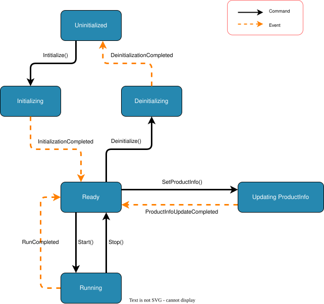

# システムステートマシン

ステート マシンは、各システム ライフサイクル状態でどのコマンドが有効であるかを定義します。クライアントはコマンドを送信する前に、現在の状態を使用してそのコマンドが許可されるかどうかを判断する必要があります。

## 状態

|状態 |意味 |
| --- | --- |
| `Uninitialized` |初期化されていません。初期化コマンドのみ有効です。 |
| `Initializing` | Initialize は受け入れられ、システムは完了イベントを待っています。 |
| `Ready` |アイドル。 ProductInfo 更新、開始、および初期化解除コマンドは有効です。 |
| `UpdatingProductInfo` | ProductInfo 更新が受け入れられ、システムは完了イベントを待っています。 |
| `Running` |実行がアクティブです。内部実行フェーズは公開状態ではありません。 |
| `Deinitializing` | Reset/Deinitialize cleanup is in progress. |
| `Faulted` | Classified fault latched; Reset cleanup and explicit Initialize are required. |

## コマンドとイベント

コマンドは、クライアントまたはオペレーターからの要求です。システムは、現在の状態で有効なコマンドのみを受け入れます。

イベントはシステムによって生成された結果です。これらは中間状態を完了するか、長時間実行されたアクションが終了したことを示します。

## 状態遷移

実線のトランジションはコマンドを表します。破線の遷移はイベントを表します。

## コマンドの有効性

|コマンド |有効な状態 |受け入れ後の結果 |
| --- | --- | --- |
| `Initialize` | `Uninitialized` | `Initializing` に遷移します。 `InitializationCompleted` は状態を `Ready` に変更します。 |
| `SetProductInfo` | `Ready` | `UpdatingProductInfo` に遷移します。 `ProductInfoUpdateCompleted` は状態を `Ready` に戻します。 |
| `Start` | `Ready` |現在の ProductInfo スナップショットをキャプチャし、`Running` に遷移します。 |
| `Stop` | `Running` |アクティブな実行を停止し、状態を `Ready` に戻します。 |
| `Deinitialize` | `Ready`, `Faulted`, `Deinitializing` | success → `Uninitialized`; cleanup failure → `Faulted`. |
| `Reset` | `Running`, `Ready`, `Faulted`, `Deinitializing`; idempotent in `Uninitialized` | stop + cleanup → `Uninitialized`; explicit Initialize → `Ready`. |

## 拒否されたコマンド

上の表に記載されていない状態から送信されたコマンドは無効です。無効なコマンドは一貫して拒否する必要があり、現在の状態を変更してはなりません。

たとえば、状態が `Running` であるときに `SetProductInfo` を送信することは、状態が `Ready` であるときにのみ ProductInfo を変更できるため、無効です。

## 復旧契約

2.4.0 の分類済み障害は公開状態 `Faulted` と `recoveryAction: "Reset"` を返します。Reset は停止と必要なクリーンアップを完了し、成功すると `Uninitialized` になります。`cleanup_failed` は `Faulted` を維持します。その後の明示的 Initialize だけが `Ready` に戻し、旧作業は再開しません。実際の state、errorCode と復旧情報を確認してください。`RequiresDeinitialize` は公開状態ではありません。

復旧ペイロードには、任意の `recoveryStartedAt`、`recoverySource`、`recoveryPhase`、サニタイズ済みの `recoveryDetails`、およびエラー/コマンド用の安定した `errorCode` も含めることができます。これらは追加フィールドであり、クライアントは未知のフィールドを無視します。

## 結果のスナップショット

`Start` は、現在の `ProductInfo` をすぐにキャプチャします。生成された結果はそのスナップショットを使用します。将来の実装で実行中に製品情報を変更できるようになったとしても、その変更はすでに開始されている実行の結果に影響を与えてはなりません。

現在のステート マシンでは、`SetProductInfo` は `Ready` でのみ有効であるため、`Running` 中に ProductInfo を変更することはできません。
